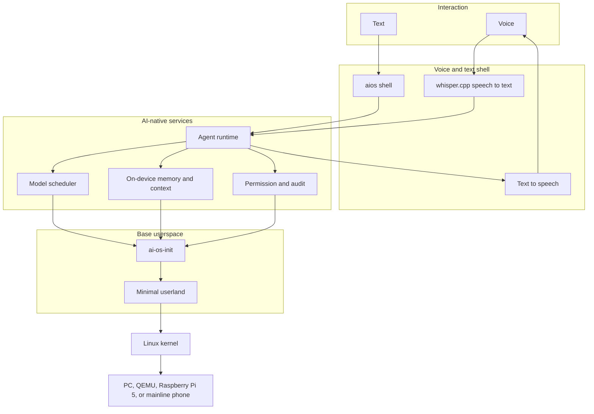
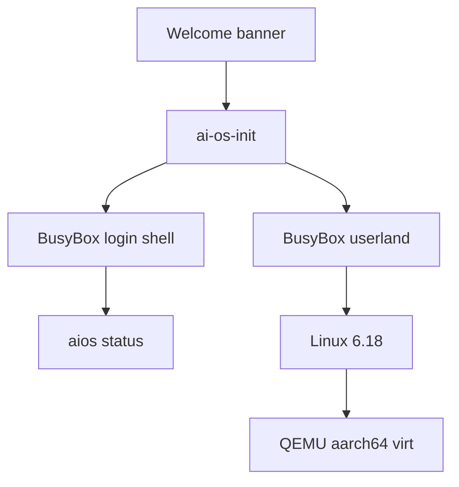

# Architecture

AI Native OS uses the Linux kernel and replaces the usual userspace. Android, AOSP, GNOME, and KDE are out of scope. The system has to run on ordinary PCs. An NPU may be used when present and ignored when it is not.

The owner of the project is Gauhar Nadeem.

## Target stack

### Hardware and kernel

The kernel is mainline Linux, built with Buildroot. Phase 1 targets QEMU `virt` on aarch64. x86_64 QEMU, Raspberry Pi 5, and phones that boot mainline Linux come later, as additional board configs, not as a different userspace. Device-specific firmware stays in the board files.

### Base userspace

`ai-os-init` is PID 1. It mounts the virtual filesystems, prints the banner, and starts a shell. BusyBox supplies the classic Unix tools. There is no systemd, OpenRC, or desktop session.

### Permission and audit

Every later AI action is supposed to pass through a permission and audit layer: who asked, what ran, what changed, and how to reverse it. The layer is visible to the user. Phase 1 does not implement it. Nothing in phase 1 performs an AI action, so there is nothing to audit yet. The layer should exist before the agent runtime does.

### Model scheduler

The scheduler runs a small local model through llama.cpp. A cloud model is a second choice and starts only after the user consents. The decision is an audit event. Phase 1 does not link llama.cpp and does not open a network connection for inference.

### Agent runtime

The agent operates programs and the UI on the user's behalf. Actions that change state require confirmation. It uses the memory service for context and the scheduler for tokens. It is not part of this phase.

### Memory

Personal memory and context stay on the device and are permissioned. Export is explicit. The service is not part of this phase.

### Shell

The shell is text first and voice second. Voice uses whisper.cpp for speech-to-text, plus a text-to-speech path. Phase 1 ships a serial shell and the `aios` status command.

## Phase 1 slice

What this repository actually builds:

Boot path:

1. QEMU `virt` loads `Image` and attaches `rootfs.ext4` as a virtio-mmio block device.
2. Linux mounts the ext4 image as `/` (`root=/dev/vda`, `console=ttyAMA0`).
3. The kernel execs `/sbin/init`, which is `ai-os-init`.
4. `ai-os-init` mounts proc, sysfs, devtmpfs, `/dev/pts`, `/run`, and `/tmp`, remounts `/` read-write, prints `shell/banner.txt`, and respawns `/bin/sh -l` on the console.
5. `aios status` reads hostname, kernel, uptime, and `/run/aios/init.state`, then reports the planned services as not installed.

The development image logs in as root with no password on the serial console. It does not bring up a network. Treat it as a lab image.

## Buildroot external tree

`br2-external/` is a BR2_EXTERNAL tree named `AIOS`. Buildroot is downloaded, not committed. The packages are thin:

| Package | Installs |
| --- | --- |
| `ai-os-init` | `services/ai-os-init/ai-os-init` as `/sbin/ai-os-init` and `/sbin/init` |
| `aios` | `shell/aios` as `/usr/bin/aios`, the banner, and `/etc/profile.d/aios.sh` |

The defconfig `aios_qemu_aarch64_defconfig` selects the Arm GNU AArch64 toolchain (so the image build does not compile GCC), Linux 6.18.7 with the QEMU `virt` board config, BusyBox, an ext4 root filesystem, and `BR2_INIT_NONE` so our init is the only init.

## Targets after phase 1

| Order | Target | What changes |
| --- | --- | --- |
| Now | QEMU aarch64 `virt` | This defconfig |
| Next hardware | QEMU x86_64, if a PC image is needed before Pi 5 | A second defconfig and kernel config |
| Then | Raspberry Pi 5 | Board files, device tree, boot firmware |
| Later | Mainline-Linux phones | A new board config only where mainline already boots |

Userspace stays the same across those targets. An NPU shows up as an accelerator the scheduler may use, not as a requirement to boot.
